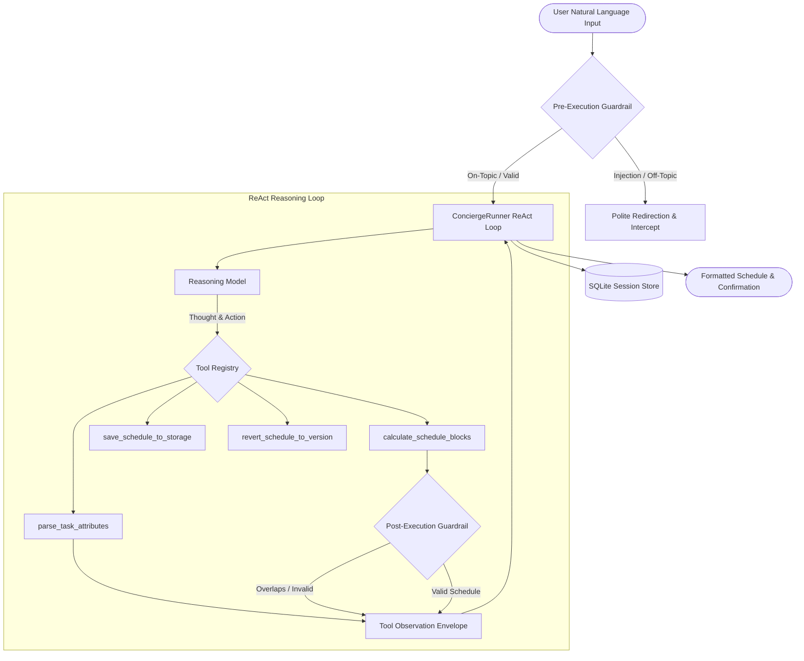

# Daily Routine & Task Concierge

> An executive-grade personal assistant agent that ingests natural-language to-dos, scores priorities and cognitive load, packs realistic non-overlapping schedules with recovery buffers, and provides event-sourced runtime version control.

[](https://www.python.org/)
[](https://docs.pydantic.dev/)
[](https://sqlite.org/)
[](LICENSE)

---

## Overview

The **Daily Routine & Task Concierge** is an autonomous agent built with a single **ReAct (Reasoning + Acting) loop with deterministic validation barriers**. It transforms messy, freeform daily notes and brain dumps into structured, chronobiologically optimized daily agendas while safeguarding user focus and system integrity.

### Key Capabilities

- **Zero-Assumption Ingestion**: Identifies ambiguous commitments and asks clarifying questions instead of hallucinating durations or deadlines.
- **Energy-First Chronobiology**: Automatically places high-energy tasks (`Deep Work`, `Critical`, `High` priority) in early morning focus windows.
- **Cognitive Recovery Buffers**: Enforces mandatory 10-minute recovery slack intervals following any deep work sprint.
- **Event-Sourced Version Control**: Snapshots each confirmed schedule change with monotonically increasing `version_id`s, enabling instant rollbacks via `revert_schedule_to_version`.
- **Bidirectional Safety Guardrails**:
  - *Pre-Execution*: Intercepts prompt injection attacks and off-topic queries with zero LLM token overhead.
  - *Post-Execution*: Prohibits overlapping time allocations and ensures strict 24-hour boundary compliance.
- **ACID Session Persistence**: Preserves multi-turn conversational history and working memory in a local SQLite store across restarts.
- **Circuit Breaker**: Halts runaway recursive tool iterations at `max_iterations = 5`.

---

## System Architecture



---

## Project Structure

```
.
├── schemas.py          # Strict Pydantic v2 domain models (TaskItem, DailySchedule, AgentState, ScheduleVersion)
├── tools.py            # Deterministic functions, buffer packers, snapshotting, and OpenAI tool specs
├── agent_config.py     # System prompt, behavioral guidelines, and dynamic ToolRegistry
├── runner.py           # Primary ReAct execution loop, circuit breaker, and state manager
├── guardrails.py       # Pre-execution injection interceptor and post-execution schedule validator
├── session_store.py    # ACID-compliant SQLite session store preserving state across turns
├── simulation_e2e.py   # Multi-turn lifecycle simulation (ambiguity -> tools -> schedule -> save)
├── test_tools.py       # Deterministic tools & OpenAI schemas test suite
├── test_guardrails.py  # Prompt injection and temporal overlap safety test suite
├── test_runner.py      # Multi-turn loop and circuit breaker test suite
├── test_versioning.py  # Event sourcing, snapshots, and rollback test suite
├── requirements.txt    # Project dependencies (Pydantic v2)
├── .env.example        # Environment variable template
└── .gitignore          # Production security ignore rules (.env, .venv, caches, runtime outputs)
```

---

## Installation & Setup

### 1. Clone the Repository
```bash
git clone https://github.com/KaushikkkV/daily-routine-agent.git
cd daily-routine-agent
```

### 2. Set Up Virtual Environment
```bash
python -m venv .venv

# On Windows (PowerShell):
.\.venv\Scripts\Activate.ps1

# On Linux / macOS:
source .venv/bin/activate
```

### 3. Install Dependencies
```bash
pip install -r requirements.txt
```

### 4. Configure Environment
Copy the `.env.example` template to `.env`:
```bash
cp .env.example .env
```
Populate your credentials in `.env`:
```env
OPENAI_API_KEY=your_openai_api_key_here
MODEL_NAME=gpt-4o-mini
```

---

## Running the Simulation & Tests

### Run the End-to-End Simulation
Demonstrates the complete multi-turn lifecycle (Turn 1: Clarification Request, Turn 2: Schedule Generation with Buffers, Turn 3: User Confirmation & Storage):
```bash
python simulation_e2e.py
```

### Run the Complete Test Suite
```bash
# 1. Deterministic Tool Suite
python test_tools.py

# 2. Safety Guardrails & Injection Defense
python test_guardrails.py

# 3. Primary ReAct Loop & Circuit Breaker
python test_runner.py

# 4. Schedule Version Control & Rollbacks
python test_versioning.py
```

---

## Operational Guardrails & Rules

1. **Zero Assumption Policy**:
   If an activity lacks clear duration or priority, the agent halts schedule generation and queries the user for specifics.
2. **Explicit Storage Confirmation**:
   The agent is strictly forbidden from executing `save_schedule_to_storage` autonomously. It must present the schedule layout and await user approval (e.g., "Yes, save it").
3. **Rollback Command**:
   If the user requests to undo modifications or revert, the agent executes `revert_schedule_to_version(target_version_id=...)` to safely restore prior snapshots from history.

---

## License

This project is licensed under the MIT License. See [LICENSE](LICENSE) for details.
