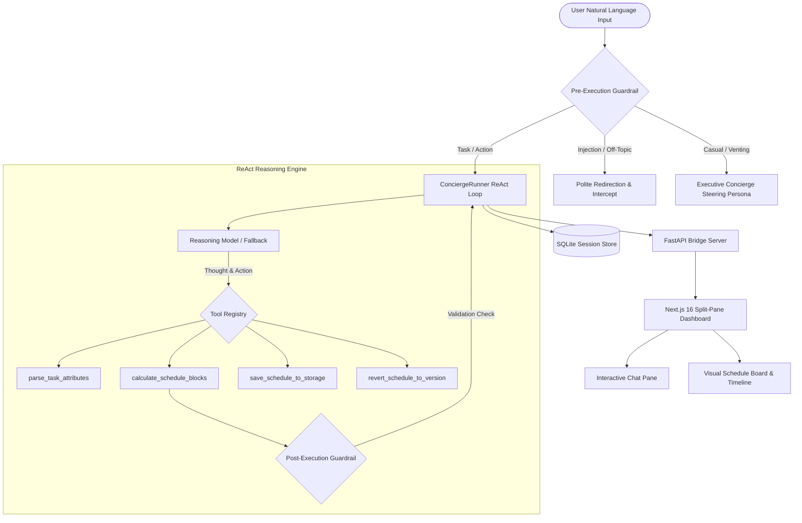

# Daily Routine & Task Concierge

> An executive-grade personal routine concierge and scheduling system that ingests natural-language to-dos and brain dumps, engages in consultative conversational steering, packs realistic non-overlapping schedules with cognitive recovery buffers, and provides a modern full-stack web interface with event-sourced version control.

[](https://www.python.org/)
[](https://nextjs.org/)
[](https://react.dev/)
[](https://fastapi.tiangolo.com/)
[](https://tailwindcss.com/)
[](https://docs.pydantic.dev/)
[](https://sqlite.org/)
[](LICENSE)

---

## Overview

The **Daily Routine & Task Concierge** is an autonomous assistant built on a **ReAct (Reasoning + Acting) execution engine with deterministic validation barriers** paired with a Next.js 16 Obsidian-dark dashboard. It transforms messy, freeform notes and brain dumps into chronobiologically optimized daily agendas while safeguarding user energy, managing cognitive load, and preventing burnout.

### Key Capabilities

- **Executive Concierge Persona & Conversational Steering**:
  - Naturally chats when user speaks casually, vents, or shares ambiguous state (`"yo"`, `"feeling tired"`, `"just had lunch"`).
  - Proactively nudges toward routine management with 2 concrete, actionable paths under 3 sentences.
  - **Confirmation Gate**: Transitions to scheduling only when user accepts or commands an action.
- **Chained Multi-Task Sequencing**:
  - Automatically unpacks multi-activity chains (e.g., *"setup meeting now, then gym and after that rest and then again meeting"*).
  - Anchors to `"now"` (current local time) and packs all blocks in **one pass** with sensible defaults.
- **Interactive Inline Scheduling Card**:
  - For unanchored isolated requests (`"i wanna go to gym"`, `"setup a meet"`), sanitizes titles (`"Gym Session"`, `"Meeting"`) and renders an inline card.
  - Features Hour (`01`–`12`) & Minute (`00`, `15`, `30`, `45`) dropdowns, segmented `[ AM ]` | `[ PM ]` toggle, single-date calendar picker, and `[15m]`, `[30m]`, `[45m]`, `[60m]` duration presets.
- **Energy-First Chronobiology**:
  - Automatically schedules high-cognitive-load `Deep Work` in morning focus windows.
  - Places lower-strain `Shallow Work` and errands in later slots.
  - Enforces mandatory 10-minute recovery buffers after deep work sessions.
- **Accurate Cognitive Balance Metrics**:
  - `Total Work` metric strictly sums occupational commitments (Deep Work, Shallow Work, Errands), excluding sleep, rest, and personal routines.
- **Event-Sourced Version Control & Instant Rollbacks**:
  - Snapshots every confirmed schedule with immutable `version_id`s.
  - Roll back any previous version via chat (`"revert to version 1"`) or UI buttons.
- **One-Click Calendar Exports**:
  - Exports schedules directly to standard `.ics` files compatible with Apple Calendar, Google Calendar, and Microsoft Outlook.
- **Bidirectional Safety Guardrails**:
  - *Pre-Execution*: Intercepts prompt injections and off-topic trivia with zero LLM overhead.
  - *Post-Execution*: Prohibits overlapping slots and guarantees strict 24-hour boundary compliance.

---

## System Architecture



---

## Project Structure

```
.
├── api.py                     # FastAPI REST bridge server with CORS and session management
├── agent_config.py            # Executive Concierge system prompt, persona directives, and tool registry
├── runner.py                  # Primary ReAct execution loop, circuit breaker, and state tracking
├── tools.py                   # Deterministic scheduling tools, time block packers, title normalizers
├── guardrails.py              # Pre/post-execution safety guardrails, injection defense, intent detection
├── schemas.py                 # Pydantic v2 domain schemas (TaskItem, DailySchedule, AgentState, ScheduleVersion)
├── session_store.py           # SQLite ACID session store maintaining conversational state
├── requirements.txt           # Python backend dependencies (FastAPI, Pydantic v2, Uvicorn, etc.)
│
├── frontend/                  # Next.js 16 + React 19 obsidian-themed frontend
│   ├── app/
│   │   ├── globals.css        # Obsidian dark design tokens, animations, scrollbars
│   │   ├── layout.tsx         # Root layout with Inter font and metadata
│   │   └── page.tsx           # Split-pane dashboard combining ChatPane & ScheduleBoard
│   ├── components/
│   │   ├── chat/
│   │   │   ├── ChatPane.tsx       # Chat feed with ThoughtAccordion & InlineDatePickerCard
│   │   │   └── ThoughtAccordion.tsx # Collapsible ReAct reasoning traces drawer
│   │   ├── schedule/
│   │   │   ├── ScheduleBoard.tsx    # Visual day timeline, cognitive metrics, and action controls
│   │   │   └── ScheduleBlockCard.tsx# Interactive time block cards with category badges
│   │   ├── tour/
│   │   │   └── WorkspaceTour.tsx    # Interactive onboarding walkthrough
│   │   ├── ui/
│   │   │   ├── calendar.tsx         # Shadcn DayPicker calendar with constrained navigation
│   │   │   ├── button.tsx, dialog.tsx, popover.tsx, ...
│   │   └── effects/
│   │       ├── DitherVeil.tsx       # Retro grain aesthetic veil
│   │       └── Ferrofluid.tsx       # Three.js/OGL interactive fluid canvas
│   ├── hooks/
│   │   └── useConciergeSession.ts   # Session hook managing chat, schedule versions, and API sync
│   └── lib/
│       ├── api.ts                   # Type-safe API client connecting to FastAPI backend
│       └── calendarExport.ts        # RFC 5545 iCalendar (.ics) file generator
│
└── tests/
    ├── test_consultative_steering.py    # Steering persona & confirmation gate test suite
    ├── test_chained_and_enhanced_picker.py # Chained multi-task & 12-hour AM/PM test suite
    ├── test_intent_based_guardrails.py  # Intent classification & zero false-positives test suite
    ├── test_meeting_guardrail_flow.py   # Meeting request & interactive collection test suite
    ├── test_lifestyle_and_relative_time.py # Fitness/lifestyle & relative offset test suite
    ├── test_anchor_clarification_date.py# Anchor-time & duration clarification test suite
    ├── test_guardrails.py               # Prompt injection defense test suite
    ├── test_versioning.py               # Event-sourced snapshotting & rollback test suite
    ├── test_runner.py                   # ReAct loop & circuit breaker test suite
    └── test_api.py                      # FastAPI integration endpoints test suite
```

---

## Installation & Setup

### Prerequisites
- Python 3.12+
- Node.js 18+ and npm

### 1. Clone the Repository
```bash
git clone https://github.com/KaushikkkV/daily-routine-agent.git
cd daily-routine-agent
```

### 2. Backend Setup
```bash
# Create and activate virtual environment
python -m venv .venv

# On Windows:
.\.venv\Scripts\Activate.ps1

# On Linux / macOS:
source .venv/bin/activate

# Install backend dependencies
pip install -r requirements.txt
```

### 3. Frontend Setup
```bash
cd frontend
npm install
cd ..
```

### 4. Configure Environment (Optional for Live LLMs)
```bash
cp .env.example .env
```
Populate your credentials in `.env`:
```env
OPENAI_API_KEY=gsk_your_groq_api_key_here
OPENAI_BASE_URL=https://api.groq.com/openai/v1
MODEL_NAME=llama-3.3-70b-versatile
```
*(Note: If no API key is configured, the built-in `SmartFallbackLLM` autonomously handles all workflows offline with 100% deterministic fidelity).*

---

## Running the Application

### Start the FastAPI Backend Server
```bash
python -m uvicorn api:app --reload --port 8000
```
*(API Docs available at `http://localhost:8000/docs`)*

### Start the Next.js Frontend Dashboard
In a separate terminal:
```bash
cd frontend
npm run dev
```
Open `http://localhost:3000` in your browser.

---

## Running Automated Verification Tests

The repository includes comprehensive automated test suites covering all workflows:

```bash
# 1. Consultative Concierge Steering & Confirmation Gate
python test_consultative_steering.py

# 2. Chained Multi-Task Sequencing & 12-Hour AM/PM Parsing
python test_chained_and_enhanced_picker.py

# 3. Intent-Based Guardrails (Zero False-Positives)
python test_intent_based_guardrails.py

# 4. Meeting Requests & Interactive Elicitation
python test_meeting_guardrail_flow.py

# 5. Lifestyle Tasks & Relative Time Offsets
python test_lifestyle_and_relative_time.py

# 6. Anchor-Time Honoring & Duration Clarification
python test_anchor_clarification_date.py

# 7. Safety Guardrails & Injection Defense
python test_guardrails.py

# 8. Event Sourcing & Snapshot Rollbacks
python test_versioning.py

# 9. FastAPI Server REST API Integration
python test_api.py

# 10. ReAct Execution Loop & Circuit Breaker
python test_runner.py
```

---

## License

This project is licensed under the MIT License. See [LICENSE](LICENSE) for details.
